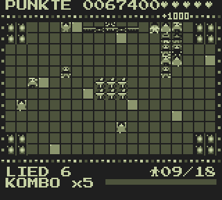
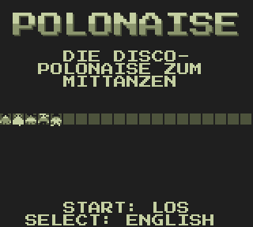
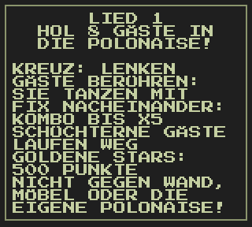
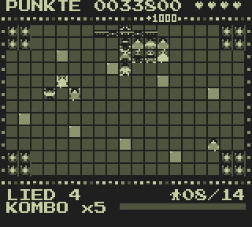
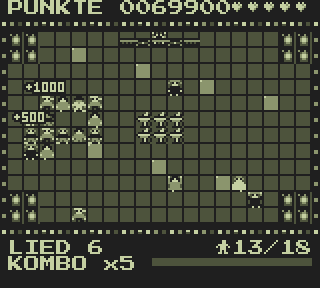
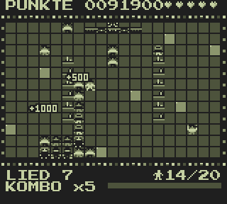
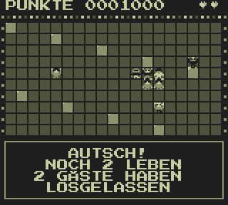
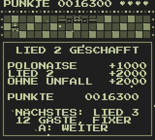
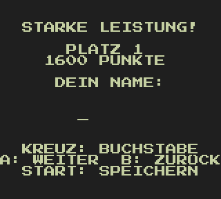

# Polonaise for the Game Boy

The disco conga line to dance along with – the browser version (`../polonaise-remake`) as a ROM for the
original Game Boy (DMG, "Game Boy Classic"), for emulators, flash cartridges – and right in the browser.
A DISCOWARE release (the publisher is made up, the game is real).



**Play it online: https://dlehmann.github.io/polonaise-gameboy/** – on a handheld built into the page.

**The ROM: [`polonaise.gb`](polonaise.gb)** (also `build/polonaise.gb` and `docs/polonaise.gb`) – 32 KB, MBC1
with 8 KB battery-backed RAM for the high score list.

| Title screen                          | How to play                       | Song 4: the speakers               | Song 6: combo ×5                   |
|---------------------------------------|-----------------------------------|------------------------------------|------------------------------------|
|    |  |       |       |
| **Song 7: through the bar**           | **Ouch!**                         | **Song cleared**                   | **New high score**                 |
|          |       |    |   |

## Controls

| Game Boy             | Keyboard on the web page       | Effect                                                    |
|----------------------|--------------------------------|-----------------------------------------------------------|
| D-pad                | arrow keys or WASD             | steer the polonaise                                       |
| A                    | X                              | continue (song intro, summary)                            |
| B                    | Z                              | back (name entry)                                         |
| START                | Enter                          | start; in the game: pause                                 |
| SELECT               | Shift                          | on the title: German/English; in the pause: end the game  |

In the name entry up/down choose the letter, left/right or A/B the position, START saves.

## The game

Lead the line across the dance floor, touch the guests and they join at the end. One after the other quickly
makes a combo up to ×5, shy guests run away, golden stars bring 500 points. A wall, the furniture or the own
line costs a life and half of the polonaise. Enough dancers clear the song; the next one wants more of them at
a faster beat – endless songs on eight floors.

The 10 best results (name of up to 8 characters, score, song) are kept in the cartridge RAM, together with the
last name entered and the language. Emulators keep it in a `.sav`/`.ram` file next to the ROM, the web page in
the browser's localStorage.

## What is the same and what is different

The game logic is the same: `src/game.c` is a port of `game.ts` with the same time base (60 ticks per
second, one per frame; the Game Boy shows 59.7 frames per second), the same songs, eight floors, points,
combos, shy guests, golden stars and extra lives. Two things are done differently for speed – the random
numbers come from a 16-bit xorshift instead of the original's linear congruential generator, and new guests
are placed by trying random cells first instead of listing all free cells – which changes the course of a
game, not its rules.

The playfield has the original 19 × 12 cells, at 8 × 8 pixels each: the people are tiny (12 looks after the
browser version's hair styles, dresses and glasses, the leader in a white disco suit with sunglasses), drawn
onto the floor tiles of the background. The polonaise jumps from cell to cell, as on the C64. The field is
moved half a tile to the right so that it sits in the middle of the 20 columns of the screen.

Moving to the beat: the LED frame, the DJ behind the desk, the speakers and the lit floor tiles. Floating
points, sparkles around stars, "!" over fleeing shy guests, dizzy stars after a crash, arrows next to the
waiting leader and confetti for a cleared song are sprites. Panels (song intro, crash, summary, pause, game
over) appear at the bottom of the screen in the window layer.

The music is the arcade's disco loop (16 bars at 120 bpm: bass drum, clap, hi-hats, octave bass, chord stabs,
melody) on the Game Boy's sound chip: chords and melody on channel 2, the bass on the wave channel, the drums
on the noise channel; the effects (modelled on the C64 version) have channel 1 to themselves and borrow the
noise channel for a moment when they need it.

In later songs, with a long polonaise and a fast beat, the Game Boy does not always manage a whole tick per
frame: songs 1–6 run at 96–100 % speed, later ones at about 90 %. The music always keeps its tempo: it is
played in the vertical blank interrupt, not in the game loop.

Not carried over: the mirror ball light spots, the glowing band under the polonaise, the gliding movement.

## The web page

`docs/` is the project's GitHub Pages site (in the repository settings under *Pages*: *Deploy from a branch*,
the branch and the folder `/docs`). To look at it locally: `python3 -m http.server --directory docs`.

| File                  | Contents                                                                               |
|-----------------------|----------------------------------------------------------------------------------------|
| `docs/index.html`     | the page: the playable handheld, the controls, how to play, the poster                 |
| `docs/style.css`      | its look: club lights, a lit dance floor, the handheld drawn in CSS                    |
| `docs/gb.js`          | a small Game Boy emulator written for this page: CPU, display, timer, sound, MBC1      |
| `docs/play.js`        | the handheld: screen, sound (Web Audio), keyboard, buttons for mouse and touch, saving |
| `docs/impressum.html` | Impressum and privacy policy (in German)                                               |
| `docs/img/`           | the screenshots and the animation (`make shots`); the mirror ball and the poster of    |
|                       | Polonaise Guy come from the C64 version's artwork (`tools/art.py ../polonaise`)        |
| `docs/polonaise.gb`   | the ROM, kept up to date by `make`                                                     |

The page loads nothing from other servers: the font Press Start 2P (SIL Open Font License, `docs/fonts/`)
and the emulator are part of it. `gb.js` covers what this game needs – the SM83 instruction set, a display
drawn a line at a time with background, window and sprites, the timer, the joypad, all four sound channels
and an MBC1 cartridge; it also runs in Node.js (`require('./docs/gb.js')`) for tests.

## Building

Requires: GBDK-2020 (4.4.0) in `tools/gbdk`, Python 3 with Pillow (and PyBoy for the screenshots and tests)
and the browser version in `../polonaise-remake` (the font Press Start 2P comes from there).

```
curl -L https://github.com/gbdk-2020/gbdk-2020/releases/download/4.4.0/gbdk-linux64.tar.gz | tar xz -C tools
python3 -m venv tools/venv && tools/venv/bin/pip install pillow numpy pyboy
make            # the ROM
make shots      # the screenshots in docs/img
```

`make` generates the files in `gen/` from `tools/gfx.py` (all tiles: font, people, furniture, logo,
sprites; a preview in `build/tiles.png`), `tools/text.py` (texts in German and English) and
`tools/music.py` (music, effects), compiles `src/` and writes `build/polonaise.gb`, `polonaise.gb` and
`docs/polonaise.gb`.

| File            | Contents                                                                        |
|-----------------|---------------------------------------------------------------------------------|
| `src/main.c`    | flow: title screen, game loop, pause, panels, name entry                        |
| `src/game.c`    | the game logic (port of `game.ts`)                                              |
| `src/render.c`  | the screen: dance floor, people, lights, status lines, panels, sprites, text    |
| `src/sound.c`   | sound chip: music and effects                                                   |
| `src/save.c`    | the high score list in the cartridge RAM                                        |

Notes on the Game Boy and SDCC, learnt the hard way:

- All tiles are loaded at `$8000` with `set_sprite_data()`: `set_bkg_data()` would put tiles 0..127 at
  `$9000` while the display still uses the signed addressing of GBDK's start-up.
- The video RAM is written by `vset()` and friends, with interrupts off between the check of the display mode
  and the write – otherwise an interrupt in between can make the write miss.
- SDCC 4.4 compiled `if (a != b) { a = b; ... }` for the status line into storing the *difference*; the
  assignments there come last now (see `hud()`).
- The music runs in the vertical blank interrupt (`add_VBL(sound_tick)`), the functions the game calls change
  its state with interrupts off. Played from the game loop, it lost a frame whenever the loop did – most of
  all on the summary screen, where everyone dances to the beat.
- Divisions and multiplications of 32-bit numbers take thousands of cycles: numbers are turned into digits by
  subtraction, and the per-frame code avoids them. The people are redrawn only when something changed, the
  floor lights and the status lines wait for a frame with time to spare.

## Tests

`tools/autoplay.py` plays in PyBoy by itself (it reads the game state from the RAM and steers to the nearest
guest), takes screenshots and reports the speed per song and the tempo of the music per phase; `tools/run.py` plays a fixed script of button
presses and takes screenshots or records the sound:

```
tools/venv/bin/python tools/autoplay.py build/polonaise.gb out 14000      # 14000 frames, screenshots in out/
tools/venv/bin/python tools/autoplay.py build/polonaise.gb out 6000 400   # with 400 of 1000 steps wrong
tools/venv/bin/python tools/run.py build/polonaise.gb wait:100 press:start wait:200 shot:intro.png
tools/venv/bin/python tools/run.py build/polonaise.gb wait:600 sound:title.wav
```

To play it outside the browser: `tools/venv/bin/pyboy polonaise.gb -w SDL2 -s 4 --sound-volume 100`
(arrows, A = `A`, B = `S`, START = Enter, SELECT = Backspace).

## Licence notes

The font Press Start 2P by CodeMan38 is under the SIL Open Font License (`docs/fonts/OFL.txt`). Game Boy is a
trademark of Nintendo; this is an unofficial fan project.
